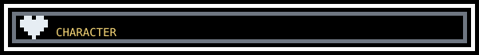
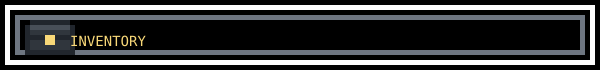
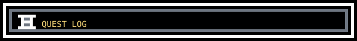
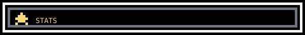
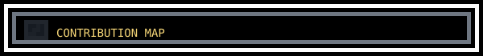
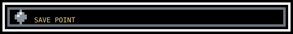
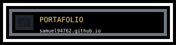
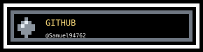

<!-- Header -->




```text
NAME ........ Samuel Parada
CLASS ....... Full-Stack Developer
HOMETOWN .... Santa Cruz de la Sierra, Bolivia
WEAPONS ..... FastAPI · Node.js · PHP · C# / .NET · C++
SHIELDS ..... React · TypeScript · Tailwind
MAGIC ....... Power Apps · Power Automate · Dataverse · Power BI
TRAINING .... Ingeniería de Software
SIDE QUESTS . BJJ 🥋 · gym 🏋️
```

<br/>



<div align="center">


<br/>

<br/>

<br/><br/>


</div>

<br/>



| Quest | Qué es | Stack |
|---|---|---|
| 🌐 [**Portafolio**](https://github.com/Samuel94762/portafolio-samuel) | Mi portafolio personal | React · Tailwind |
| 🚲 [**Bike Store**](https://github.com/Samuel94762/bike_store_tw1) | Tienda web de bicicletas | Web |
| 🗂️ [**Proyecto PW2**](https://github.com/Samuel94762/proyecto_pw2_backend) | Sistema full-stack ([backend](https://github.com/Samuel94762/proyecto_pw2_backend) / [frontend](https://github.com/Samuel94762/proyecto_pw2_frontend)) | API + SPA |

<br/>



<div align="center">


</div>

<br/>



<div align="center">
<picture>
  <source media="(prefers-color-scheme: dark)" srcset="https://raw.githubusercontent.com/Samuel94762/Samuel94762/output/github-snake-dark.svg" />
  <source media="(prefers-color-scheme: light)" srcset="https://raw.githubusercontent.com/Samuel94762/Samuel94762/output/github-snake.svg" />
  
</picture>
</div>

<br/>

<div align="center">



<a href="https://samuel94762.github.io"></a>
&nbsp;
<a href="https://github.com/Samuel94762"></a>

</div>


